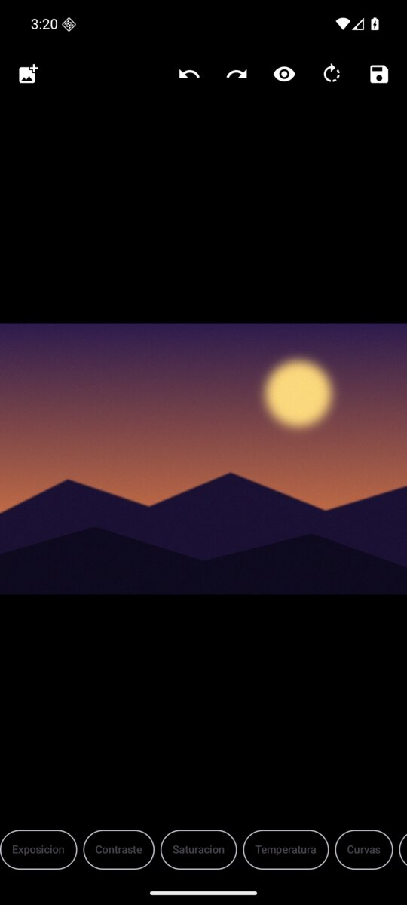
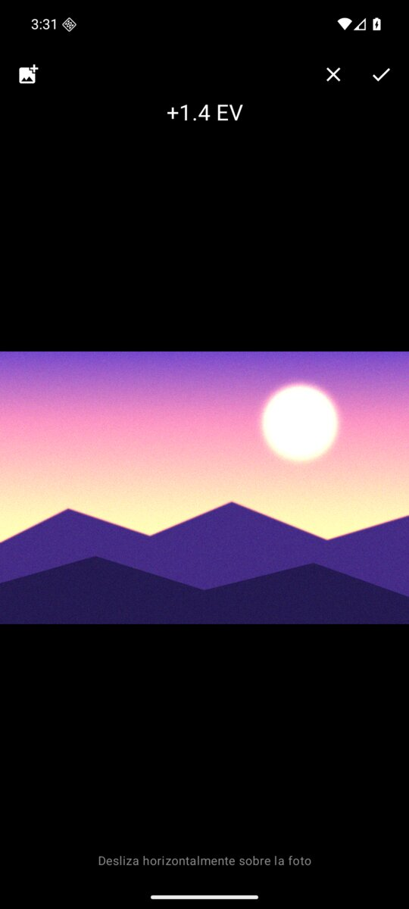
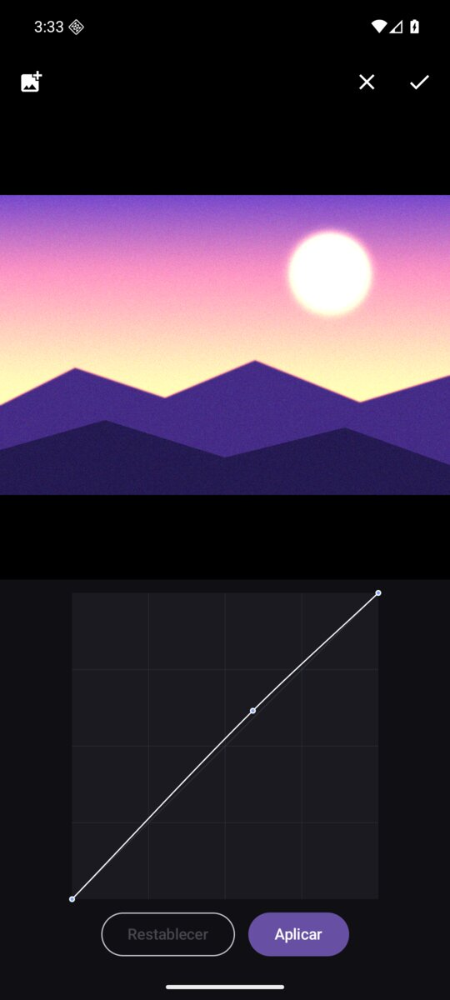
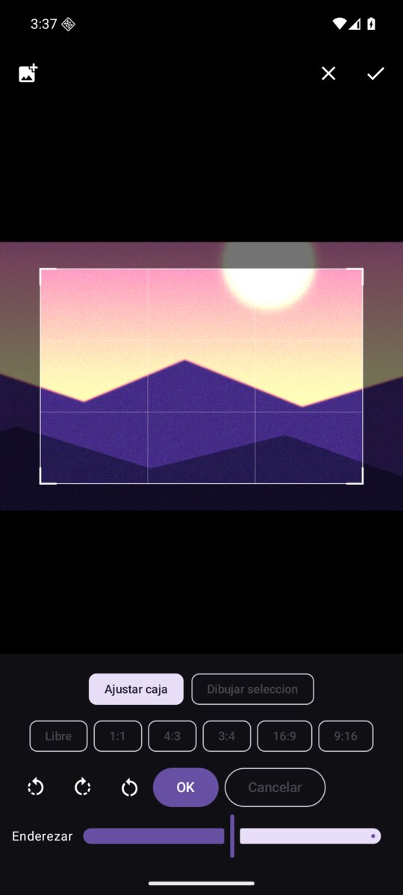
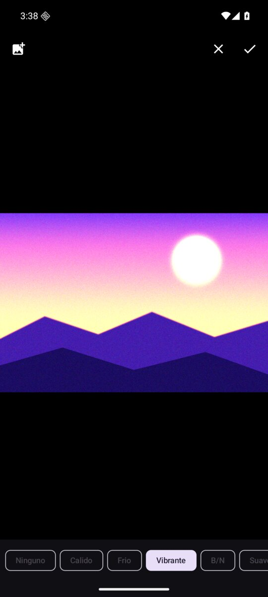
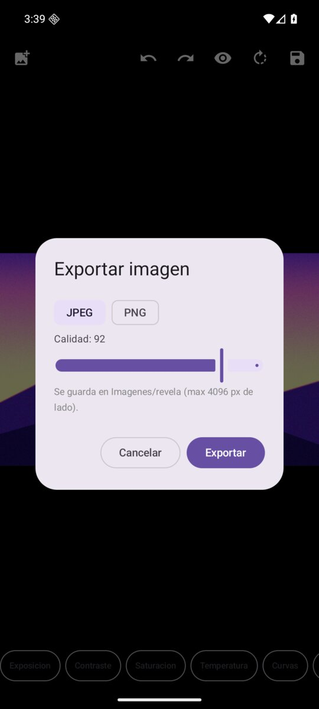

# revela

An offline photo editor for Android. Non-destructive, gesture-driven, no accounts, no cloud, no tracking, no ads. It edits the photo you pick and writes the result to your gallery. That is all it does.

The workflow is inspired by Snapseed (tap a tool, drag horizontally to adjust), but this is a clean-room implementation: no code, assets or names from Google or Nik Software. I wanted an editor in that style that stays fully offline and under my control, so I wrote one.

## Features

- Non-destructive edit stack with undo/redo; the session is restored when you reopen the same photo
- Exposure, contrast, saturation and white balance (temperature/tint) by dragging horizontally over the photo
- Interactive tone curve editor: tap to add points, drag to move, long-press to delete (monotonic cubic interpolation, no overshoot)
- Crop with adjustable box or free draw, aspect ratios (free, 1:1, 4:3, 3:4, 16:9, 9:16), 90 degree rotation and straightening from -45 to 45 degrees with a thirds grid
- Selective adjustments: up to 8 control points with local brightness, contrast and saturation (color-similarity weighted falloff)
- Vignette
- 7 built-in looks: none, warm, cold, vibrant, B&W, soft, film
- Healing brush: paint over a spot, inpainting fills it (pure Kotlin diffusion, no OpenCV)
- Export to JPEG or PNG with quality setting, saved to Pictures/revela via MediaStore, EXIF carried over, orientation baked in
- Pinch to zoom (up to 6x) and pan to inspect the result
- 100% offline. The only thing the app touches is the photo you explicitly pick with the system Photo Picker

## Screenshots

| Editor | Exposure drag | Curves |
|---|---|---|
|  |  |  |

| Crop and rotate | Looks | Export |
|---|---|---|
|  |  |  |

(The UI is currently Spanish-only. The screenshots show a synthetic test image.)

## Performance

Measured on an x86_64 emulator with a 24 MP (6000x4500) source, so real phones should be faster:

- Decode to preview (1500 px): ~170 ms
- Live re-render per adjustment: ~60 ms full pipeline, 9-12 ms color-only
- Full-resolution export of the 24 MP photo: ~580 ms

The whole pipeline runs on CPU in plain Kotlin. No GPU, no native libraries.

## Tech notes

- Color engine: per-channel lookup tables combining exposure, white balance, contrast and curve, plus a saturation pass on Rec.709 luma. One implementation shared by preview (1440 px) and export (full resolution), so what you see is what you get.
- Frame pipeline shared by preview and export, in frame space: heal, then global color, then selective points, then vignette. Crop and rotation are applied as the final geometric transform.
- Healing: diffusion inpainting (BFS layering + Jacobi relaxation), pure Kotlin, JVM-testable.
- Stack: Kotlin 2.4, Jetpack Compose (BOM 2026.09), AGP 9.4, Gradle 9.8, compileSdk 37, minSdk 29. Release build is minified with R8 (about 2 MB APK).
- 37 JVM unit tests cover the math core (curves, color, geometry, heal masks, edit stack).

## Build

```
./gradlew assembleDebug
```

You need an Android SDK (android-37 platform, build-tools 36). Point `sdk.dir` in `local.properties` to it, or set `ANDROID_HOME`.

Release builds read signing config from `keystore.properties` in the repo root (gitignored):

```
storeFile=/path/to/your.keystore
storePassword=...
keyAlias=...
keyPassword=...
```

## Status

MVP. Things I may add later: better inpainting for large areas (possibly OpenCV), RAW support, more looks, English UI. The repository is private for now; licensing to be decided if I publish it.
