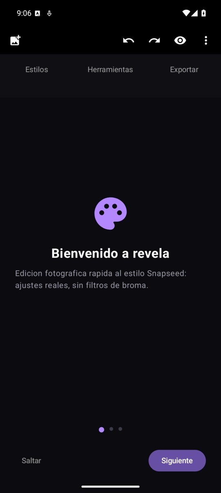
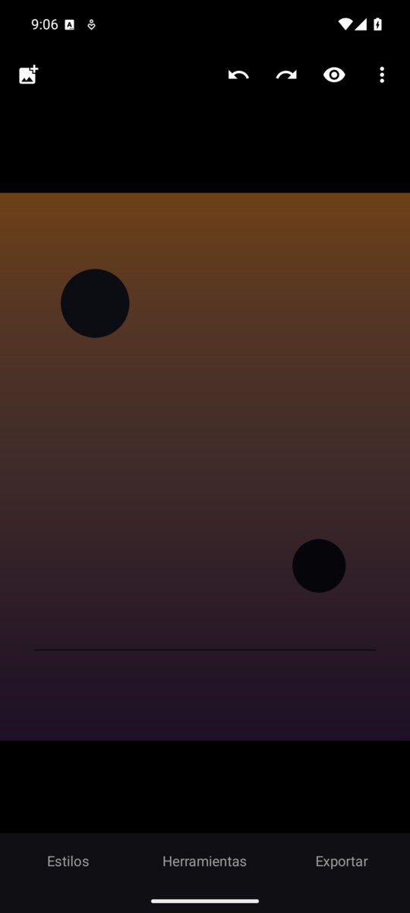
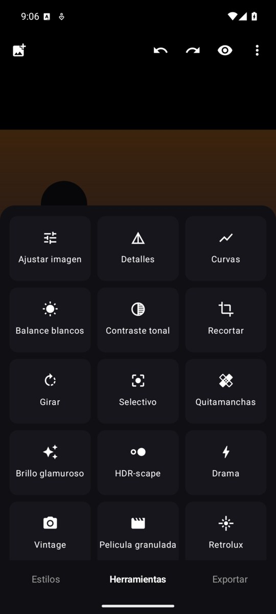
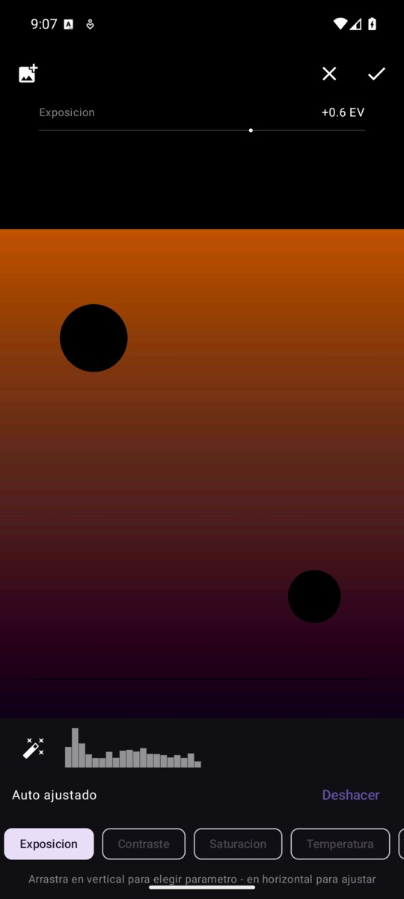

# revela

An offline photo editor for Android in the style of Snapseed. Non-destructive, gesture-driven, no accounts, no cloud, no tracking, no ads. It edits the photo you pick and writes the result to your gallery. That is all it does.

The workflow is inspired by Snapseed (tap a tool, drag to adjust), but this is a clean-room implementation: no code, assets or names from Google or Nik Software. I wanted an editor in that style that stays fully offline and under my control, so I wrote one.

## Features

**24 tools, ordered like Snapseed's grid:**

- **Ajustar imagen** (Tune image): exposure, contrast, saturation, temperature and tint via the signature gesture — drag vertically to pick the parameter, horizontally to set the value, with a fine top ruler and live preview
- **Auto**: one-tap auto levels (histogram percentiles → exposure/contrast/micro-saturation) with an undo snackbar
- **Live histogram** of the current render
- **Detalles** (structure + sharpening via separable box blur unsharp), **HDR-scape** (local contrast), **Grain** (deterministic noise)
- **Curvas**: interactive tone curve, tap to add points, drag to move, long-press to delete (monotonic cubic, no overshoot)
- **Balance de blancos** (temperature/tint), **Contraste tonal** (shadows/midtones/highlights zone LUTs)
- **Recortar**: box or free draw, ratios (free, 1:1, 4:3, 3:4, 16:9, 9:16), straighten -45..45 with thirds grid
- **Girar**: 90° rotations
- **Selectivo**: up to 8 U-point-style control points with local brightness/contrast/saturation (color-similarity falloff)
- **Quitamanchas** (healing): paint over a spot, diffusion inpainting fills it (pure Kotlin, no OpenCV)
- **Presets con intensidad**: Drama, Vintage, Película granulada, Retrolux, Grunge, Noir, Retrato, Brillo glamuroso
- **Blanco y negro** with channel filters (neutral/red/yellow/green/blue)
- **Desenfoque** (radial lens blur), **Viñeta**
- **Doble exposición**: pick a second photo, blend with normal/screen/multiply/lighten/darken
- **Texto** and **Marcos** (frames)
- **Custom styles**: save your current adjustments as a named style with a live thumbnail, reapply with one tap
- **Welcome wizard** (first launch, skippable), pinch to zoom up to 6x, before/after hold-to-compare
- Non-destructive edit stack with undo/redo; the session is restored when you reopen the same photo
- Export to JPEG or PNG with quality setting, saved to Pictures/revela via MediaStore, EXIF carried over, orientation baked in
- 100% offline. The only thing the app touches is the photo you explicitly pick with the system Photo Picker

## Screenshots

| Welcome | Editor (Looks) | Tools (24) | Tune + Auto |
|---|---|---|---|
|  |  |  |  |

(The UI is currently Spanish-only. The screenshots show a synthetic test image.)

## Performance

Measured on an x86_64 emulator with a 24 MP (6000x4500) source, so real phones should be faster:

- Decode to preview (1500 px): ~170 ms
- Live re-render per adjustment: ~60 ms full pipeline, 9-12 ms color-only
- Full-resolution export of the 24 MP photo: ~580 ms

The whole pipeline runs on CPU in plain Kotlin. No GPU, no native libraries.

## Tech notes

- Color engine: per-channel lookup tables combining exposure, white balance, contrast, tonal zones and curve, plus a saturation pass on Rec.709 luma. One implementation shared by preview (1440 px) and export (full resolution), so what you see is what you get.
- Frame pipeline shared by preview and export, in frame space: heal, then global color, then B&W, then selective points, then vignette. Spatial effects (details, glow, HDR, lens blur, grain) run as pipeline stages. Text and frames are composited after the pipeline.
- Healing: diffusion inpainting (BFS layering + Jacobi relaxation), pure Kotlin, JVM-testable.
- Stack: Kotlin 2.4, Jetpack Compose (BOM 2026.09), AGP 9.4, Gradle 9.8, compileSdk 37, minSdk 29. Release build is minified with R8 (about 2 MB APK).
- 64 JVM unit tests cover the math core (curves, color, tonal zones, geometry, heal masks, edit stack, auto levels, B&W filters, blend modes, custom style codec).

## Build

```
./gradlew assembleDebug
```

You need an Android SDK (android-37 platform, build-tools 36). Point `sdk.dir` in `local.properties` to it, or set `ANDROID_HOME`.

Release builds read signing config from `keystore.properties` in the repo root (gitignored); without it, debug builds work out of the box:

```
storeFile=/path/to/your.keystore
storePassword=...
keyAlias=...
keyPassword=...
```

## Roadmap

Perspective, expand, brush, head pose (the four Snapseed tools still missing), a layer view for the edit stack, export settings (sizing/format), and an English UI.

## License

[AGPL-3.0](LICENSE). Copyright 2026 Nacho (github.com/gnacho).
